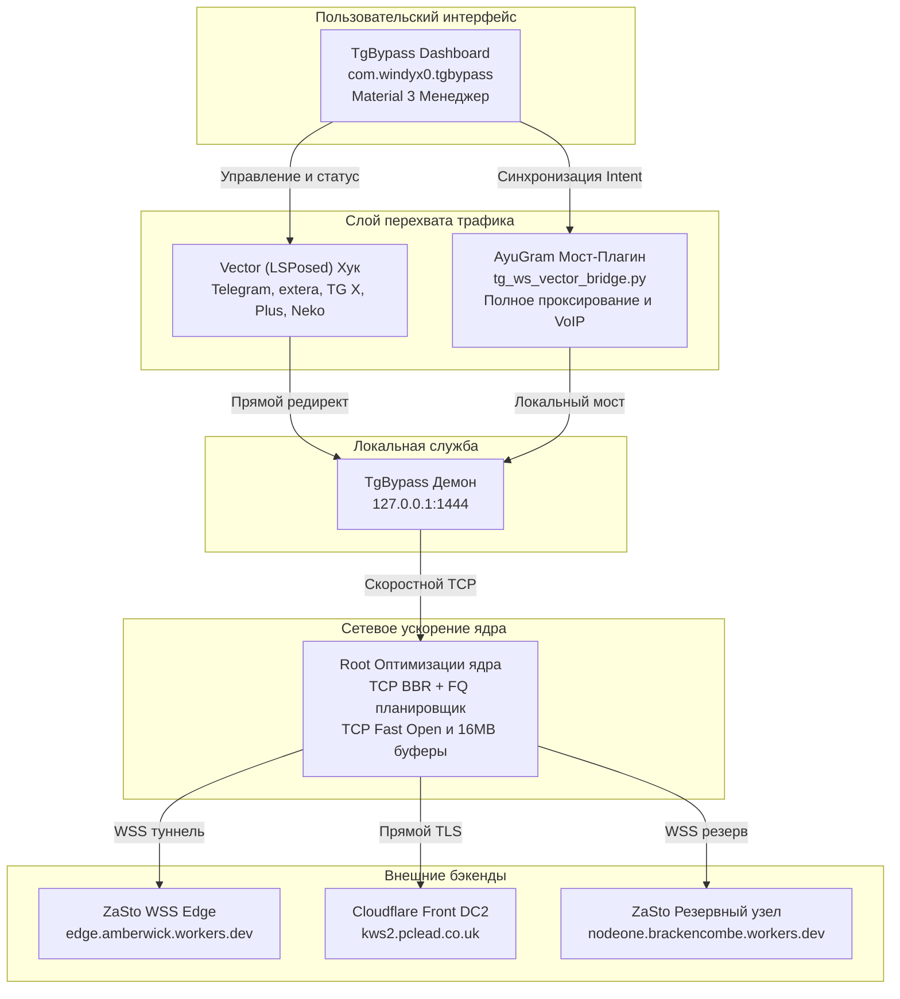

[English](README.md) | Русский

# TgBypass All-In-One

Комплексная система обхода блокировок Telegram и сетевой акселератор ядра Linux для Android.

TgBypass объединяет автономный фоновый сервис WebSocket-туннеля, модуль хуков Vector (LSPosed), оптимизатор сетевого стека Linux (TCP BBR, TFO, QoS) и мост-плагин для AyuGram в единую согласованную экосистему.

---

## Архитектура решения

Комплекс состоит из четырех взаимосвязанных компонентов:



---

## Основные возможности

- **Автоматическая настройка в один клик**: кнопка "Автонастройка и починка" в приложении автоматически активирует модуль в LSPosed, настраивает область действия для установленных клиентов, разворачивает плагин в AyuGram и запускает локальный прокси.
- **Оптимизация сетевого стека Linux (Network Turbo)**:
  - Алгоритм контроля перегрузок TCP BBR с планировщиком пакетов FQ.
  - TCP Fast Open (TFO) для клиента и сервера (устраняет задержку первого RTT).
  - Отключение сброса окна при простое (`tcp_slow_start_after_idle = 0`).
  - Расширение сетевых буферов до 16 МБ для максимальной скорости передачи медиа.
  - Приоритизация трафика Telegram через QoS (DSCP AF41 / Low Delay).
  - Обход отслеживания соединений conntrack (`NOTRACK`) на интерфейсе loopback.
  - Path MTU Probing для предотвращения фрагментации и обрывов на мобильных сетях.
- **Двусторонняя синхронизация бэкенда**: переключение рабочего сервера (локальный демон, ZaSto WSS, Cloudflare) мгновенно синхронизируется между приложением TgBypass и плагином AyuGram через Intent-шину и общую память.
- **Поддержка всех типов трафика**: корректная маршрутизация текстовых сообщений, медиафайлов, каналов, историй, а также голосовых и видеозвонков (VoIP).
- **Встроенный диагностический чекер**: измерение задержки (RTT / latency) до пограничных узлов Cloudflare и бэкендов обхода с цветовой индикацией состояния.
- **Бесшовный интерфейс без мерцания**: статус компонентов системы сохраняется между сессиями; при повторном открытии приложение не мигает ложными ошибками во время фоновой перепроверки.

---

## Поддерживаемые клиенты Telegram

| Клиент | Пакет | Метод интеграции | Поддержка звонков (VoIP) |
|---|---|---|---|
| AyuGram | `com.radolyn.ayugram` | Python Bridge Plugin | Да |
| Официальный Telegram | `org.telegram.messenger` | Vector (LSPosed) Hook | Да |
| Telegram Direct (Web) | `org.telegram.messenger.web` | Vector (LSPosed) Hook | Да |
| exteraGram | `app.exteragram.messenger` | Vector Hook / Plugin | Да |
| Telegram X | `org.thunderdog.challegram` | Vector (LSPosed) Hook | Да |
| Plus Messenger | `org.telegram.plus` | Vector (LSPosed) Hook | Да |
| Nekogram | `tw.nekomimi.nekogram` | Vector (LSPosed) Hook | Да |
| Cherrygram | `cc.modery.cherrygram` | Vector (LSPosed) Hook | Да |

---

## Поддерживаемые бэкенды обхода

1. **TgBypass Local Daemon** (`127.0.0.1:1444`):
   Локальный MTProto / WebSocket прокси, работающий автономно на устройстве.
2. **ZaSto WSS Cloudflare Edge** (`edge.amberwick.workers.dev:443`):
   Высокоскоростной туннель через пограничные серверы Cloudflare Workers.
3. **ZaSto WSS Reserve Node** (`nodeone.brackencombe.workers.dev:443`):
   Резервный распределенный узел с независимой маршрутизацией.
4. **Cloudflare Direct Front DC2** (`kws2.pclead.co.uk:443`):
   Прямой европейский транспорт дата-центра Амстердам.

---

## Способы установки

### Вариант 1: Модуль Magisk / KernelSU / APatch (Рекомендуемый)

Модуль включает все компоненты в едином flashable архиве:
1. Загрузите релизный архив `TgBypass-Module-v1.2.2.zip`.
2. Откройте приложение Magisk, KernelSU или APatch.
3. Перейдите во вкладку "Модули" -> "Установить из хранилища".
4. Выберите архив и подтвердите установку.
5. Перезагрузите устройство.

Модуль автоматически:
- Установит приложение `TgBypass-v1.2.2.apk`.
- Активирует модуль в LSPosed / Vector и настроит область видимости.
- Развернет и включит плагин в AyuGram (при наличии).
- Применит сетевые оптимизации TCP BBR / TFO.
- Запустит фоновую службу прокси на порту 1444.

### Вариант 2: Ручная установка APK + LSPosed

1. Установите `TgBypass-v1.2.2.apk`.
2. Откройте менеджер LSPosed (или Vector Framework).
3. Перейдите в список модулей, включите **TgBypass**.
4. В области действия (Scope) отметьте установленные клиенты Telegram (кроме AyuGram).
5. Откройте TgBypass и нажмите **Автонастройка и починка всех клиентов**.

### Вариант 3: Только плагин AyuGram (Без Root)

Если у вас нет Root-прав, но установлен AyuGram:
1. Скопируйте файл `tg_ws_vector_bridge.py` на устройство.
2. В AyuGram откройте: Настройки -> Настройки AyuGram -> Плагины.
3. Нажмите кнопку добавления плагина (+) и выберите `tg_ws_vector_bridge.py`.
4. Включите плагин в списке.

---

## Управление через консоль (Root CLI)

При установленном модуле в терминале доступна системная команда `tg-ws-proxy`:

```bash
su
tg-ws-proxy status               # Показать статус службы, порта и BBR
tg-ws-proxy start                # Запустить прокси-демон
tg-ws-proxy stop                 # Остановить прокси-демон
tg-ws-proxy restart              # Перезапустить службу
tg-ws-proxy autostart on|off     # Управление автозапуском при включении
tg-ws-proxy apply-tg auto        # Применить прокси в основной Telegram
tg-ws-proxy apply-tg all         # Применить конфигурацию во все клиенты
tg-ws-proxy set-target <пакет>   # Выбрать клиент по умолчанию
tg-ws-proxy tune-net             # Переприменить сетевое ускорение ядра
```

---

## Сборка из исходного кода

### Требования

- JDK 17 или новее.
- Android SDK (API 34/35, Build Tools 34.0.0+).
- Python 3.8+ (для скриптов упаковки релиза).

### Сборка приложения

```bash
cd upstream
./gradlew :tgbypass:assembleDebug
```

Собранный APK будет доступен по пути:
`upstream/tgbypass/build/outputs/apk/debug/tgbypass-debug.apk`

### Упаковка модуля Magisk

```bash
python scripts/package_release.py
```

Скрипт формирует архивы в каталоге `release/`:
- `TgBypass-Module-v1.2.2.zip`
- `TgBypass-v1.2.2.apk`
- `tg_ws_vector_bridge.py`

---

## Решение проблем

- **Красный статус "Порт 1444 не отвечает"**:
  Откройте приложение TgBypass и нажмите кнопку "Автонастройка и починка всех клиентов" либо выполните в терминале `su -c tg-ws-proxy restart`.
- **AyuGram не подключается через плагин**:
  Убедитесь, что в менеджере LSPosed пакет `com.radolyn.ayugram` исключен из области действия модуля TgBypass. AyuGram работает через прямой Python-мост; одновременный ART-хук может вызывать конфликт.
- **TCP BBR не активируется**:
  Некоторые пользовательские ядра не содержат модуль `tcp_bbr`. В этом случае скрипт ускорения автоматически откатывается на `cubic` или `westwood` с сохранением остальных твиков буферов и TFO.

---

## Лицензия и благодарности

- Автор проекта: **windyx0**
- Автор базового транспорта: **bol-van** (zapret / nfqws)
- Проект распространяется под лицензией MIT.
